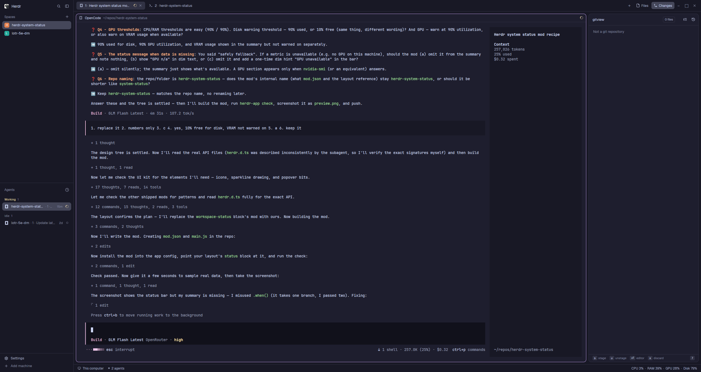

# herdr-system-status

A drop-in replacement for Herdr's status bar: everything the shipped bar shows — machine, branch, agent count — plus live system metrics and a VS Code–style status message on the right. Click the metrics for a popup with the last five minutes of CPU and GPU as trend lines.



## What you get

- **Left**, as in the shipped `workspace-status`: the machine ("This computer", or the active space's machine), the git branch, and `N agents` — with `· M needs you` in red when an agent is blocked.
- **Right**, the status message: `CPU 3%  ·  RAM 42%  ·  GPU 21%  ·  Disk 70%`, sampled every 5 seconds. A metric that isn't available (no GPU, for instance) is omitted silently.
- **Warnings**: when CPU, RAM or GPU go over 90% — or free disk space drops below 10% — the summary collapses to just the offending metrics in red: `CPU 96%  ·  Disk 9% free`.
- **Trend lines**: clicking the metrics opens a popup anchored just above the bar — the last 5 minutes of CPU, and GPU (with VRAM) when a GPU answered. Esc or a click outside closes it.

## Install

1. Copy the mod into your Herdr config:

   ```sh
   cp -r mods/herdr-system-status ~/.config/herdr-app/mods/
   ```

2. Point your layout's status bar at it. In `~/.config/herdr-app/layouts/<your-layout>.json`, find the `status` block and change its content:

   ```json
   { "id": "status", "type": "block", "size": { "px": 28 }, "content": { "mod": "herdr-system-status" } }
   ```

   It replaces the shipped `workspace-status` — both at once would draw the same facts twice.

No `keys.json` changes are needed: the mod is read-only and binds no keys.

## Requirements

- Herdr, any recent version.
- Linux for CPU, RAM and disk (reads `/proc` and `df`). On other platforms those metrics are silently omitted.
- Optional: `nvidia-smi` for the GPU row (utilization + VRAM). Without it the bar simply has no GPU part.
- Disk is measured on `/` only.

## Remove

Delete `~/.config/herdr-app/mods/herdr-system-status/` and point your layout's `status` block back at `workspace-status`.

## For agents

`RECIPE.md` is the full build spec — what the person sees, how it behaves, every API call it makes. `AGENTS.md` has the repo's conventions for coding agents.
