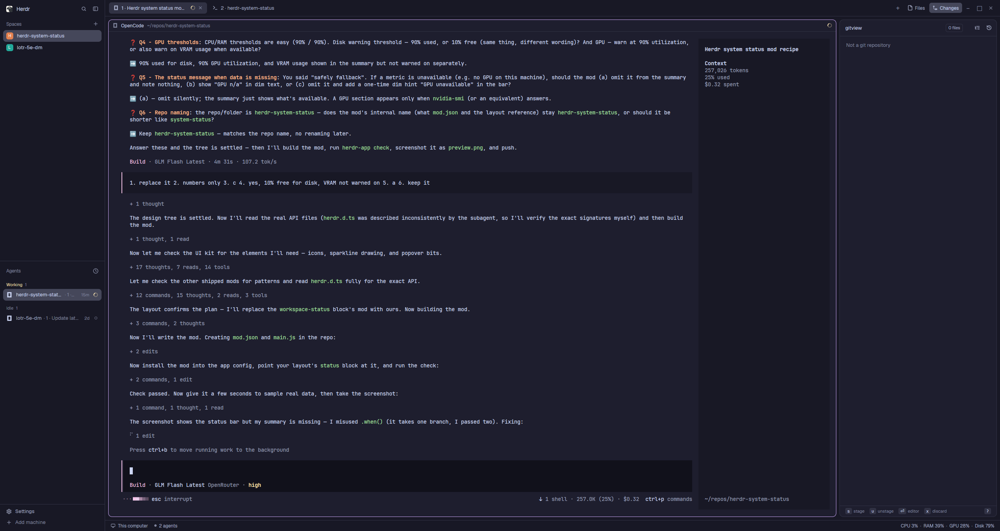

# Herdr system status

A replacement for the shipped `workspace-status` bar: everything it shows — machine, branch, agent count — plus live system metrics and a VS Code–style status message on the right of the same 28px chrome bar. Clicking the metrics opens a popover with the last five minutes of CPU and GPU as trend lines.

## What you see

One 28px bar along the bottom of the window: `theme().chrome` background, a 1px `theme().border` top edge, 14px side padding, 11.8px text in `theme().muted`. Left to right:

- A monitor icon (or a server icon when the active space lives on another machine) with the machine name — "This computer" locally.
- The active space's git branch, when it has one, with a branch icon.
- A 6px dim dot and "N agents"; when an agent is blocked, "· M needs you" appended in `theme().blocked` red.
- On the far right, the **status message**: a summary like `CPU 3%  ·  RAM 39%  ·  GPU 28%  ·  Disk 70%` — the metrics that answered, joined by dim middots. A metric that is unavailable (no GPU, for instance) is omitted silently; before the first CPU sample the bar shows `…`.
- When a threshold trips, the summary collapses to just the offending metrics in `theme().blocked` red: `CPU 96%  ·  Disk 9% free`.

## How it behaves

- Samples every 5 seconds. CPU% is the busy fraction of `/proc/stat` between consecutive samples; the first tick has no delta, so it shows `…`.
- RAM% is used of total (`MemTotal − MemAvailable`, falling back to `MemFree`). Disk% is used space on `/`. GPU% is utilization from `nvidia-smi`; its VRAM (used/total GB) appears only in the popover's label, never in the bar and never warned on.
- The popover also names the hardware, inline in each trend's label: the CPU's `model name` (read once from `/proc/cpuinfo`) and the GPU's `name` (from `nvidia-smi`), appended to the label after a middot. Neither appears in the bar.
- Thresholds, hard-coded: CPU, RAM and GPU warn above 90%; disk warns below 10% free. Under a threshold the summary is muted; at or above, red.
- Hover over the status message shows the tooltip "System status — click for CPU/GPU trend lines".
- Clicking it opens a popup whose width follows the longer of the two trend labels (the model names are inline, so a long name makes a wide popup), anchored just above the status bar's right end: each trend — the CPU one, and the GPU one when a GPU answered — is its label above a row of always-60 thin accent bars sitting in a rounded chart well. The bars are `flex_1`, so they stretch or compact to fill whatever width the labels dictate, and the samples fill the fixed columns in from the left as they accumulate — the bars never change width as history grows. The GPU row is separated from the CPU one by a 1px `theme().border` divider. Esc or a click outside closes it.
- No keys, no commands: the mod is read-only. `keys.json` needs no changes.

## Built from

- `mods/herdr-system-status/` with three files: `mod.json` = `{ "place": "none" }` (the layout places it; on its own the mod is invisible), `main.js`, which default-exports one `View` class, and `snapshot.d.ts` — the declared type of the shared snapshot, read by the type check and editors only; the runtime loads JavaScript.
- Layout change (one line): in `layouts/<name>.json`, the status block's `"content"` becomes `{ "mod": "herdr-system-status" }` where it said `"workspace-status"`.
- Imports: `View`, `div`, `svg` from `gpui-kit`; `h_flex`, `v_flex` from `gpui-base`; `agents`, `spaces`, `theme`, `exec`, `props`, `openOverlay` from `herdr`.
- Shipped art: `mods/workspace-chrome/monitor.svg`, `server.svg`, `branch.svg` — drawn with `svg(...).size(13)`, tinted by the surrounding text color.
- Programs it runs through `exec`, once per tick: `cat /proc/stat`; `awk` over `/proc/meminfo` printing `MemTotal`, `MemAvailable`, `MemFree`; `df -kP /`; and `nvidia-smi --query-gpu=utilization.gpu,memory.used,memory.total,name --format=csv,noheader,nounits` (only when past its retry gate). One extra exec on the first tick only: `grep -m1 "model name" /proc/cpuinfo` for the CPU's make/model.
- Instance state: the previous `/proc/stat` sample (for the CPU delta), the CPU model string (read once, then cached), 60-sample CPU and GPU histories, a consecutive-failure count and a retry timestamp for `nvidia-smi` (three misses → back off 60 s; a later success brings the GPU row back and clears the gate).
- The popover is the same mod re-rendered: `openOverlay({ kind: "popup", mod: "herdr-system-status", props: { trends: true }, width: <computed>, at: <computed anchor> })` — the **width must be explicit**: Herdr sizes a spec-less overlay by measuring the mod _without_ these props, which renders the status bar (~420px), so a spec-less popup comes out 120px too wide. The width comes from `popupWidth()` — an estimate of the longer trend label (~6.1px/char at 11px text, 240px floor) plus padding — and both copies compute it through the same module-level helpers (`cpuLabel`, `gpuLabel`, `popupWidth`) so they always agree. The height is omitted and adapts to the content (~141px with both rows). The anchor is computed from `window.viewport_size()` minus the content's estimated height so the popup lands just above the status bar; `render` checks `props()?.trends` and draws the trends view instead of the bar. Popups close themselves on Esc or an outside click, so the overlay needs no close button.
- The chart well is the popover color blended 35% toward `theme().background` by a small `mix()` helper (hex parse + per-channel lerp, falling back to `theme().hover` when a color isn't 6-digit hex). That's "slightly darker" in a dark theme and slightly lighter in a light one, so it never hard-codes a color; the well is `rounded(6)` with `p(6)`, and the bars inside keep their own 28px area.
- The trend data travels through shared state: every tick the bar copy publishes a snapshot with `setShared("herdr-system-status", {...})` — current cpu (and its model string)/ram/disk/gpu (with its model) plus both histories — and the popup copy reads it back with `shared("herdr-system-status")`, cast to `SystemStatusSnapshot` (declared in `snapshot.d.ts`). `setShared` re-renders every mod, which is what keeps the popup's lines growing while it is open.

## Watch out

- `openOverlay` creates a **fresh copy** of the mod: its instance state is empty, so a popup that reads `this.cpuHistory` renders with no trend lines and no error anywhere. Route the data through `shared()` (the bar publishes, the popup reads), and skip sampling in the popup copy — its `init` returns early on `props()?.trends`.
- A popup opened `at: "pointer"` while the pointer sits on the bottom status bar is clipped off the window's bottom edge — it exists (`herdr-app status` lists it) but nothing is visible. Anchor it with `window.viewport_size()` (the gpui-kit global, not `herdr`'s `window()`, which has no viewport) instead.
- `.when(condition, branch)` takes **one** branch function. Passing a second as an else silently renders nothing — the first build's summary vanished with no error anywhere. Use two `.when` calls with complementary conditions.
- `herdr-app check` does not lay out the mod or run deferred work, so it passes a mod that renders empty; try it in the app before calling it done.
- Trend lines are divs (thin bars), not paths: `PathBuilder` builds a `Path` and `window.paint_path(path, color)` paints one, but there is no element factory that consumes a `Path` outside that one window method, and bars are simpler.
- CPU/RAM/disk assume Linux `/proc` and `df`. On another platform those three are silently absent; GPU still appears wherever `nvidia-smi` answers.
- Disk is measured on `/` only — other mounts are out of scope.
- The bar's left half deliberately copies the shipped `workspace-status` behavior (including its `keys()`-aware palette hint being left out); both mods in the config at once would double-render the same facts, so point the status block at one of them.
- The popup's height adapts to its content, so adding a third trend line just makes it taller — nothing to resize. The width follows the longer trend label via `popupWidth()` (see Built from for why it can't be inferred), and the bars are `flex_1`, so they follow along automatically. The anchor's content-height estimate (in `openTrends`) does need each row's height added — or the popup overlaps the status bar.

## Tooling

- Formatting and linting use `oxfmt` and `oxlint` (installed globally): `oxfmt .` to format, `oxfmt --check .` to verify, `oxlint` to lint. Configs live in `.oxfmtrc.json` (120-col print width, object literals keep their hand-written wrapping) and `.oxlintrc.json`.
- Type checking runs `tsc --checkJs` over `main.js` with no output: `npx -y -p typescript tsc -p mods/herdr-system-status/jsconfig.json`. The runtime loads only JavaScript, so the types live in JSDoc comments inside `main.js` (parameters, fields, the `theme()` colors cast to gpui-kit's `Color`) and in `snapshot.d.ts` (the shared snapshot both copies agree on). It must pass with zero errors.
- The runtime generates `mods/herdr-system-status/gpui-kit.d.ts` and `jsconfig.json` on every run; the declaration file is gitignored and excluded from both tools. Keep `jsconfig.json` — it is written once and then yours.

## Done when

- `npx -y -p typescript tsc -p mods/herdr-system-status/jsconfig.json` passes with no errors.
- `herdr-app check ~/.config/herdr-app/mods/herdr-system-status` passes.
- Within ~10 s of starting, the bar shows machine and agents on the left and `CPU …% · RAM …% · Disk …%` on the right (GPU too when `nvidia-smi` answers).
- Temporarily setting a threshold to 0 turns the summary red with only that metric; restoring it turns the summary muted again.
- Clicking the status message opens the popup; its CPU line fills with bars over the next minutes; Esc closes it.
- On a machine without `nvidia-smi`, the bar and the popover both render with no GPU part and no error.
